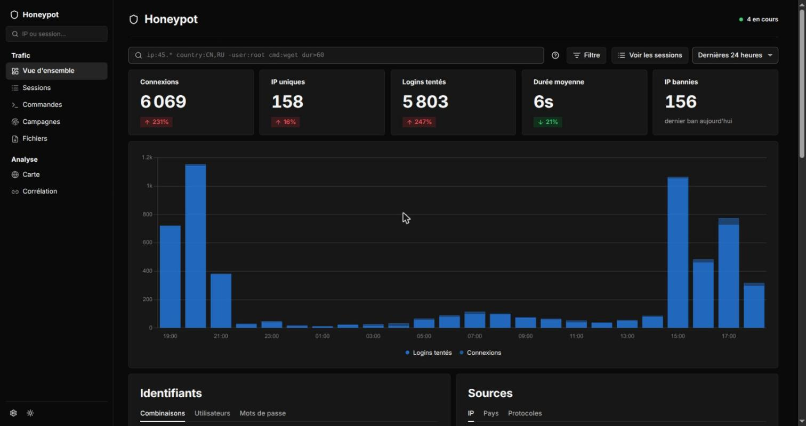
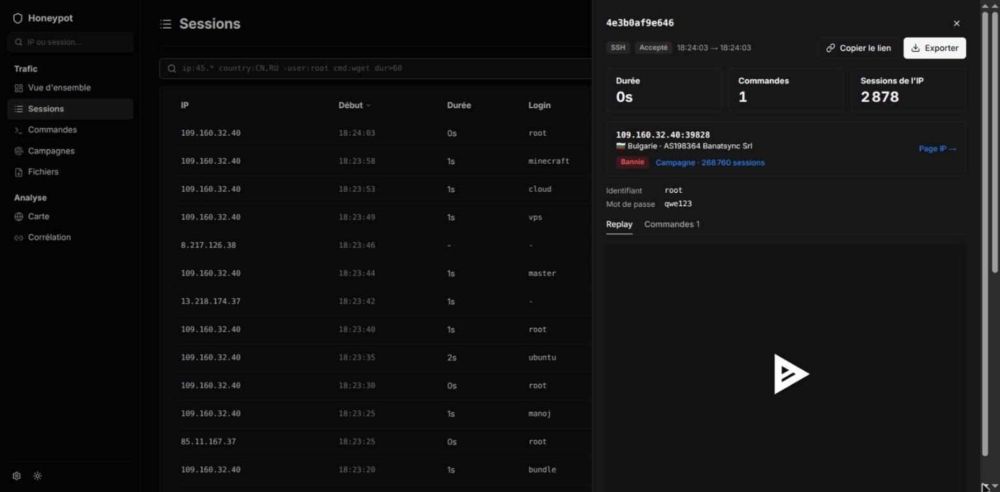
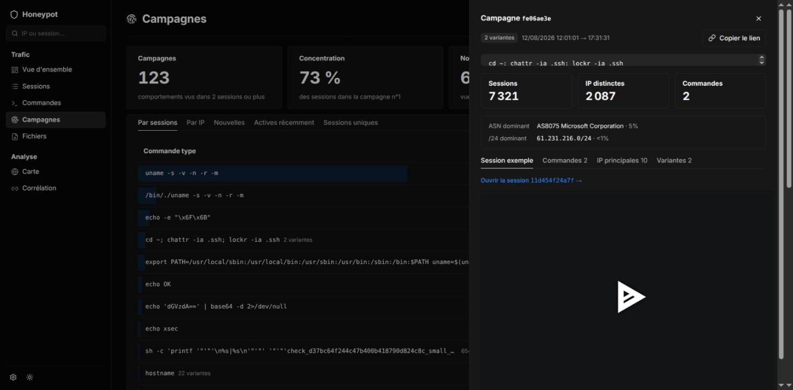
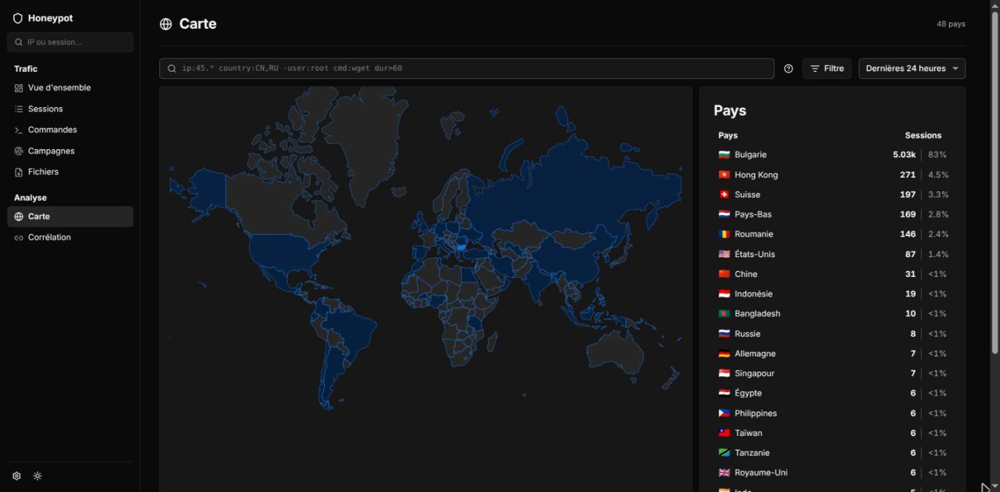

# honeypot-dashboard

[](https://github.com/rom98759/honeypot-dashboard/actions/workflows/ci.yml) [](LICENSE)

[English](README.md)

Dashboard auto-hébergé pour un honeypot SSH/Telnet [Cowrie](https://github.com/cowrie/cowrie).
Il ingère le log JSON de Cowrie, le log de fail2ban et le log d'authentification du vrai sshd dans
SQLite, et montre qui attaque ton serveur, ce que les attaquants tapent, et le lien entre honeypot,
vrai sshd et fail2ban.

> [!WARNING]
> **Cowrie prend le port 22.** Ton vrai serveur SSH doit être déplacé sur un autre port
> (`SSHD_PORT`, par ex. 50022) **avant** de lancer la stack, sinon tu te bloques dehors.
> L'installeur refuse de tourner tant que sshd écoute encore sur 22. Suis
> [l'étape 0 du guide d'installation](docs/install.fr.md#étape-0--déplacer-le-vrai-ssh-hors-du-port-22) avec attention.



| Panneau session avec replay et export | Fiche campagne |
|---|---|
|  |  |



_Captures d'un déploiement réel._

## Fonctionnalités

- **Vue d'ensemble** : tentatives, sessions, top identifiants/pays/commandes, comparaison de période, heatmap.
- **Sessions** : chaque session Cowrie avec **replay** du terminal (lecteur asciinema).
- **Recherche** : une barre de requête sur la vue d'ensemble, la carte, les sessions et les commandes, ex.
  `ip:45.* country:CN,RU -user:root cmd:wget dur>60 login:ok file:upload asn:ovh` (virgule = OU,
  `-` exclut, `*` joker, plages CIDR) ; chaque condition devient un chip supprimable, l'URL se partage.
- **Campagnes** : sessions regroupées par script exécuté, normalisées pour que jetons aléatoires, IP et
  mots de passe ne coupent pas une famille de bots.
- **Fichiers** : ce que les attaquants ont téléchargé (wget/curl), écrit (`echo … > fichier`) ou déposé
  (SFTP/scp), par session et par SHA-256 : sources, sessions, IP, lien VirusTotal, téléchargement en zip
  chiffré avec le mot de passe `infected`.
- **Carte** : attaques par pays (GeoLite2).
- **Corrélation** : la même IP vue sur le honeypot, sur le vrai sshd et bannie par fail2ban.
- **Page IP** : historique, ASN, DNS inverse, score AbuseIPDB, **ban/unban** fail2ban optionnel.
- **Bandeau santé** : prévient quand une source de logs n'est plus ingérée.

## Fonctionnement

```
                 Internet
   ┌────────────────┼──────────────────────┐
   │ :22            │ :SSHD_PORT           │ :443
   ▼                ▼                      ▼
 Cowrie          vrai sshd           reverse proxy (TLS + auth)
 (conteneur,     (hôte, jail             │
  sans sortie)    fail2ban sshd)          ▼
   │                │                 dashboard (conteneur, lecture seule)
   │ cowrie.json    │ journal               ▲
   │ (volume)       ▼                       │ SQLite
   │         exports hôte ──► /var/log/honeypot-export/
   └───────────────────────────────────────┘
```

- `docker-compose.yml` lance Cowrie et le dashboard (FastAPI + React, durci : lecture seule,
  aucune capability, non-root).
- `scripts/install-host.sh` installe la partie hôte : timers systemd qui exportent le log fail2ban et
  le journal sshd, règle pare-feu `DOCKER-USER` qui bloque toute connexion sortante de Cowrie,
  rafraîchissement GeoIP mensuel, logrotate, jails fail2ban, accès en lecture aux fichiers capturés
  par Cowrie, et worker de ban optionnel.
- Le dashboard n'a **pas de login** : il doit être derrière un reverse proxy qui ajoute l'authentification.

## Démarrage rapide

Sur un serveur Debian 12 neuf, en root, **après** avoir déplacé SSH (étape 0) :

```bash
git clone https://github.com/rom98759/honeypot-dashboard.git /opt/honeypot-dashboard
cd /opt/honeypot-dashboard
install -D -m 600 scripts/host.env.example /etc/honeypot-dashboard/host.env  # puis l'éditer
install -m 600 .env.example .env                                            # puis l'éditer
scripts/install-host.sh --dry-run && scripts/install-host.sh
docker compose up -d --build
```

Le pas-à-pas complet (prérequis, chaque réglage, reverse proxy, vérifications, mise à jour,
désinstallation, dépannage) est dans **[docs/install.fr.md](docs/install.fr.md)**.

## Modèle de sécurité

- Cowrie tourne dans un conteneur sans capability, en système de fichiers lecture seule, avec limites
  de ressources et **aucun accès réseau sortant** (règle `DOCKER-USER` sur son sous-réseau figé).
- Les ports publiés par Docker contournent ufw : les règles pare-feu sont dans `DOCKER-USER`, jamais dans ufw.
- fail2ban : le honeypot observe, les vrais services sont protégés. Quiconque touche Cowrie est banni
  du vrai sshd et des sites pendant un jour tandis que Cowrie continue de l'enregistrer ; les échecs sur
  le vrai sshd bannissent 7 jours, les récidivistes 30 (voir `docs/install.fr.md`, « Fonctionnement des bans »).
- Le ban/unban depuis le dashboard est désactivé par défaut (`FBAN_ENABLED=0`). Activé, les demandes
  passent par un répertoire de file d'attente vers un worker hôte qui n'accepte que
  `ban manual|manual-all <ip>`, `unban all <ip>` et `status all <ip>`, et refuse les adresses de
  `/etc/honeypot/never-ban` et de `ADMIN_IPS`.

## Développement

```bash
python -m venv .venv && .venv/bin/pip install -r requirements-dev.txt
.venv/bin/uvicorn app.main:app --reload     # backend sur :8000
cd frontend && npm ci && npm run dev        # frontend, proxy /api vers :8000
.venv/bin/pytest                            # tests backend + scripts
cd frontend && npm test                     # tests frontend
```

## Licence

[MIT](LICENSE). La carte du monde (`frontend/public/world.json`, `isoCountries.ts`) vient
d'[Umami](https://github.com/umami-software/umami) (MIT). Données GeoLite2 par MaxMind.
